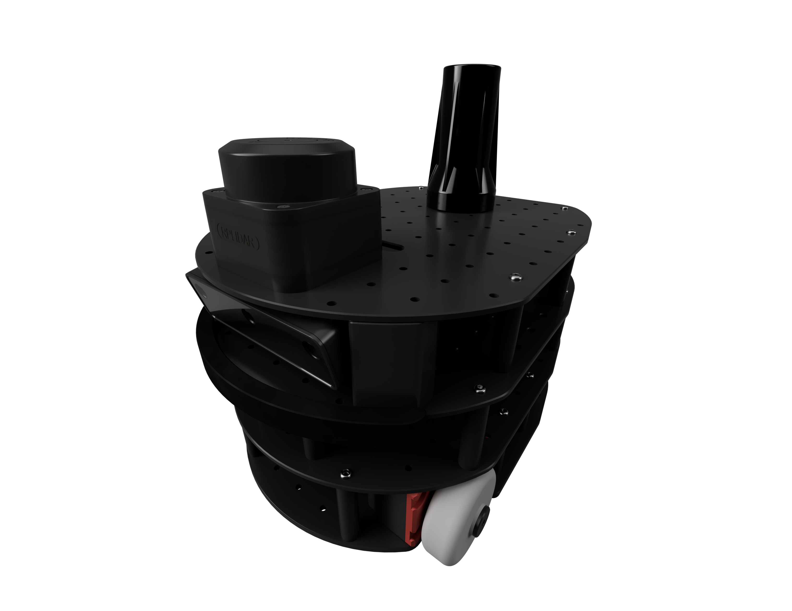
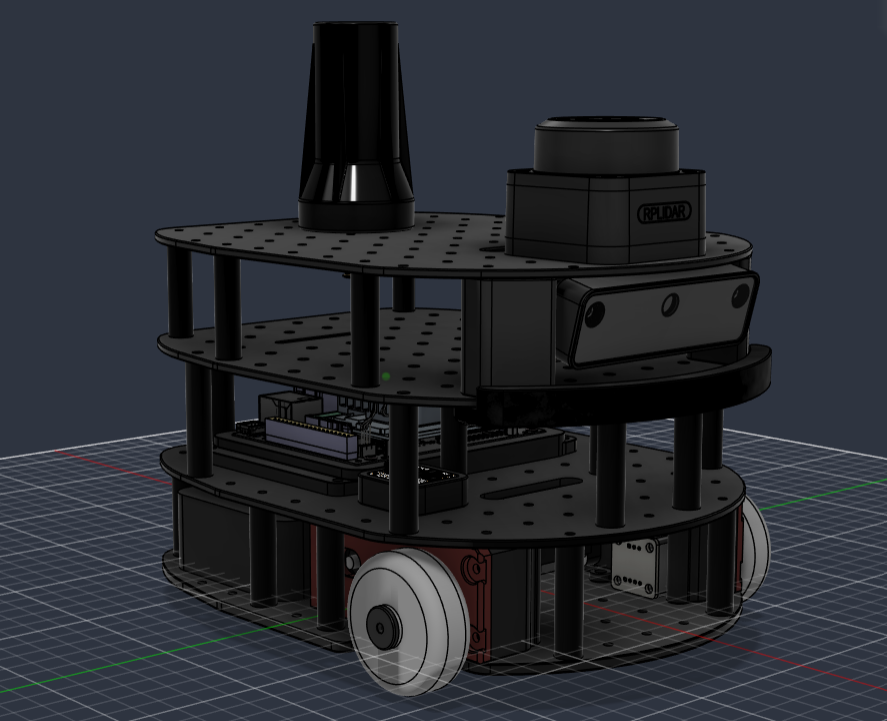
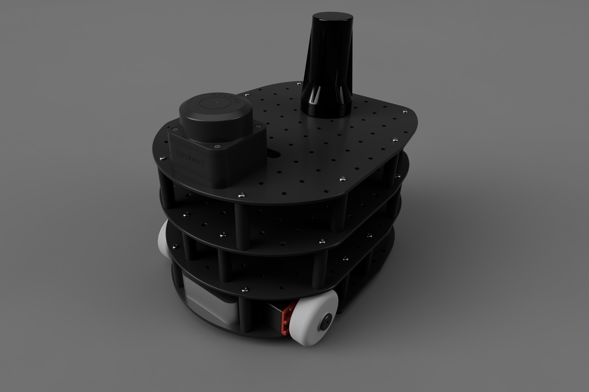
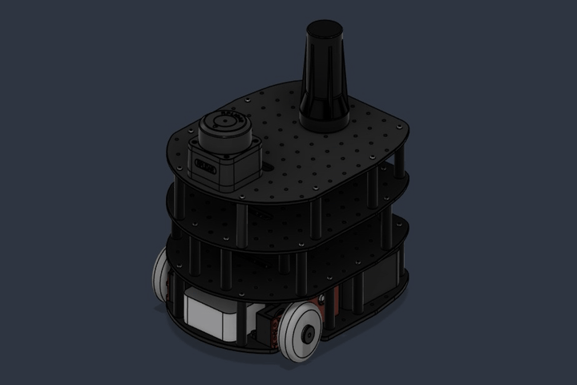
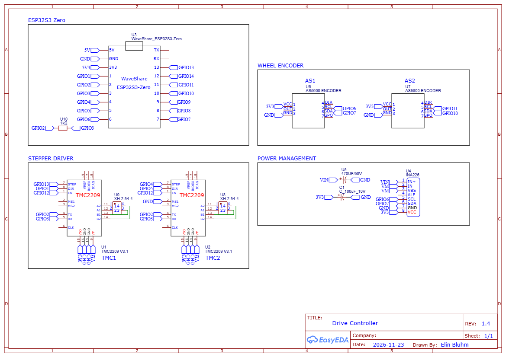
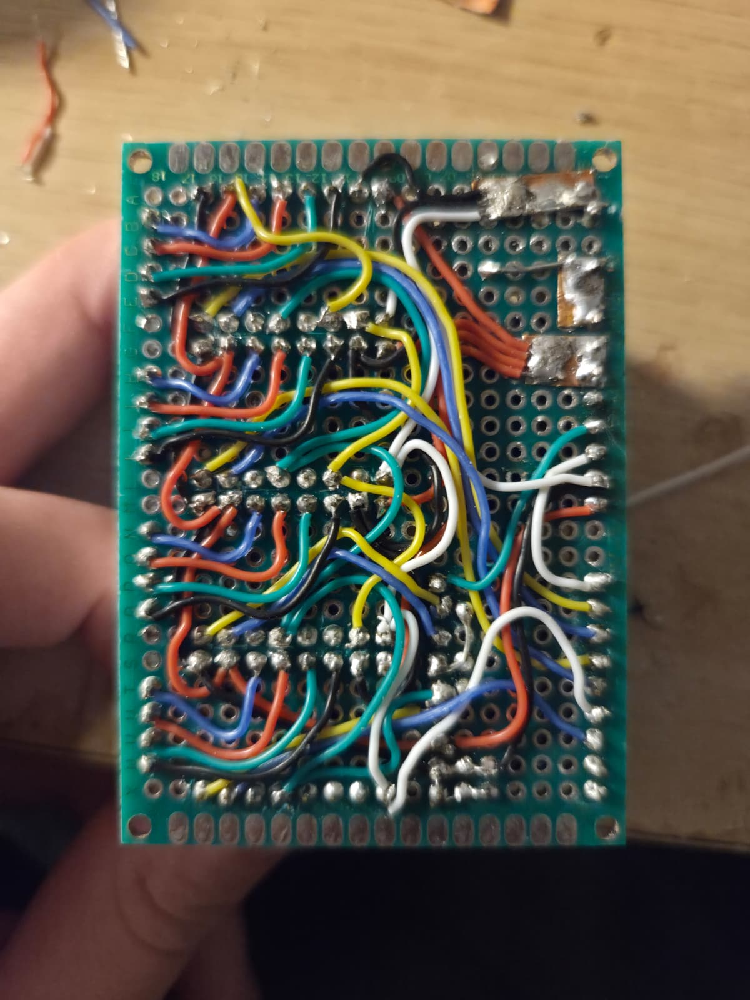

<div align="center">

# Autonomous RF-Mapping & Cognitive Radio Rover

**An autonomous indoor rover that maps and classifies real-world RF signals using ROS2, SDR and Edge AI.** <br>
*Built for **Jugend forscht 2026/2027***

[](https://docs.ros.org/en/jazzy/)
[](https://www.python.org/)
[]()
[]()

**r0.2/r0.3.x** (newest)
<br><br>



**r0.1** (legacy)
<br><br>


</div>

## What is this?

Most RF mapping tools only log basic signal strength (RSSI), which tells you *how strong* a signal is, but not *what* is actually transmitting or causing interference.

This rover combines a **HackRF One** Software Defined Radio (SDR) with autonomous 2D/3D SLAM to map indoor environments and classify RF protocols (**Wi-Fi, BLE, Zigbee, LoRa**) in real time. Instead of just logging raw power, it runs a custom CNN directly on the rover to overlay classified RF heatmaps onto the floor plan.

## Why we're building it

Wireless interference in schools, offices, and homes is invisible, yet almost everything relies on the 2.4 / 5 GHz and 868 MHz bands. We wanted to build a practical tool for **Jugend forscht 2026/2027** that can autonomously drive through a building and show where different protocols are active, where dead zones are and where signals interfere.

**Why Revision 0.3 upgrades to an NVIDIA Jetson Orin Nano:**  
Our physical r0.2 prototype currently runs on a Raspberry Pi 5 (1 GB). Even when offloading compute over Wi-Fi, the live stereo depth stream from the OAK-D Lite and SLAM are already pushing it to its limits, so adding a continuous HackRF stream plus real-time CNN inference simply won't fit in 1 GB RAM or over Wi-Fi bandwidth.


## System Architecture

### Hardware Stack (r0.3)
| Subsystem | Components |
| :--- | :--- |
| **Compute & Edge AI** | NVIDIA Jetson Orin Nano Super (upgrading from r0.2 Raspberry Pi 5 1 GB) |
| **SDR + Antenna** | HackRF One + UWB Omni-Antenna |
| **SLAM & Vision** | RPLidar C1 + Luxonis OAK-D Lite (Stereo Depth) + BNO085 (IMU) |
| **Drivetrain** | 2× NEMA 14 (42 mm), 1.77:1 metal GT2 pulley drive, 50 mm TPE wheels, 2× AS5600 magnetic encoders |
| **Motor Control** | ESP32-S3 Zero + 2× TMC2209 stepper drivers |
| **Power** | USB-C PD Powerbank + 5V 10A Buck Converter |
| **Chassis** | Custom 3D-printed PETG multi-deck frame, PA12-CF motor mounts (heat/rigidity), TPU 95A front bumper |

### Software Stack
- **OS & Middleware:** Ubuntu 24.04 LTS, ROS2 Jazzy
- **SLAM, Vision & Navigation:** Cartographer ROS, Nav2, DepthAI ROS
- **Signal Processing:** GNU Radio, SciPy, NumPy (SigMF standard)
- **Machine Learning:** TensorFlow 2, Keras
  

### Project Status & Roadmap (Work in Progress)

| Component / Milestone | Progress | Current Status & Next Steps |
| :--- | :--- | :--- |
| **Rev. 0.1 Physical Prototype** |  | **Completed:** Initial chassis build and mechanical validation. |
| **Rev. 0.2 Physical Prototype** |  | **Completed:** Integrated OAK-D Lite mount, custom TPU 95A camera bumper and upgraded to metal GT2 pulleys to eliminate backlash. |
| **Rev. 0.3 CAD Prototype** |  | Redesigned the CAD to fit an NVIDIA Jetson Orin Nano, raised the main compute deck by 5 mm for proper fan clearance and cleaned up all CAD assembly naming and structure. |
| **Autonomous Navigation (Nav2 & SLAM)** |  | **Finalizing:** 2D LiDAR SLAM, DepthAI integration & sub-0.2ms telemetry link validated; fine-tuning odometry with metal pulleys. |
| **RF Signal Classification (CNN & Calibration)** |  | **In Progress:** Pipeline architecture set up; 360° antenna calibration routine using 2.4 GHz BLE Beacon reference source underway |

### Electronics & Wiring
Instead of a fabricated PCB, the ESP32-S3 + TMC2209 motor/encoder controller is hand wired on a 5×7 cm perfboard based on our EasyEDA schematic.

<div align="center">
  
  
</div>


## Bill of Materials (BOM)

The full BOM with direct links to every part is available in [`bom.csv`](./bom.csv). Nearly all mechanical, drive, and sensor components are already owned and built into the r0.2 prototype—the grant request covers only the compute upgrade needed for r0.3.

| Item | Qty | Status | Est. Cost (Grant) |
| :--- | :---: | :--- | :---: |
| **NVIDIA Jetson Orin Nano Super Developer Kit (8 GB)** | 1 | **Needed (Grant) + shipping/taxes** | ~$550 |
| HackRF One + UWB Omni-Antenna | 1 | Already owned | 0 $ |
| RPLidar C1 | 1 | Already owned | 0 $ |
| Luxonis OAK-D Lite | 1 | Already owned (used) | 0 $ |
| BNO085 9-DOF IMU | 1 | Already owned | 0 $ |
| ESP32-S3 Zero | 1 | Already owned | 0 $ |
| TMC2209 Stepper Motor Driver | 2 | Already owned | 0 $ |
| NEMA 14 Stepper Motor (42 mm) | 2 | Already owned | 0 $ |
| AS5600 Magnetic Encoder | 2 | Already owned | 0 $ |
| Metal GT2 Pulleys & Timing Belts (1.77:1) | 2 | Already owned | 0 $ |
| 50 mm TPE Wheels | 2 | Already owned | 0 $ |
| USB-C PD Powerbank (20V/15V) + PD Trigger Board | 1 | Already owned | 0 $ |
| 5V 10A Buck Converter | 1 | Already owned | 0 $ |
| 3D-Printed Chassis (PETG, PA12-CF, TPU 95A) & M3/M2.5 Hardware/Threaded inserts | 2 | Already owned | 0 $ |
| **Total Requested from Grant** | | | **~$550** |

---

### How to use it
Power on via the USB-C PD powerbank → launch ROS2 SLAM/Nav2 + HackRF capture node → rover maps the room and logs classified RF detections → export RF heatmap

## Contact

**Team:**
- **Ben Bluhm** – Lead Developer
- **Laura Übele** – Developer
- **Miriam Hohenberger** – Developer
- **Email:** [hello@54lab.dev](mailto:hello@54lab.dev)

**Get in Touch & Follow the Build:**

[](mailto:hello@54lab.dev)
[](https://www.instagram.com/54lab.dev/)

*Follow [@54lab.dev](https://www.instagram.com/54lab.dev/) on Instagram for regular build logs, 3D printing updates, and live testing videos!*


## Repository Structure

```text
├── cad/           # Source assembly (.f3d / .step) (r0.3)
├── electronics/   # Wiring diagram and schematics (if applicable)
├── firmware/      # ESP32-S3 motor/encoder firmware
├── ros2_ws/       # Code from our ROS2 Workspace 
└── bom.csv        # Full Bill of Materials with links
