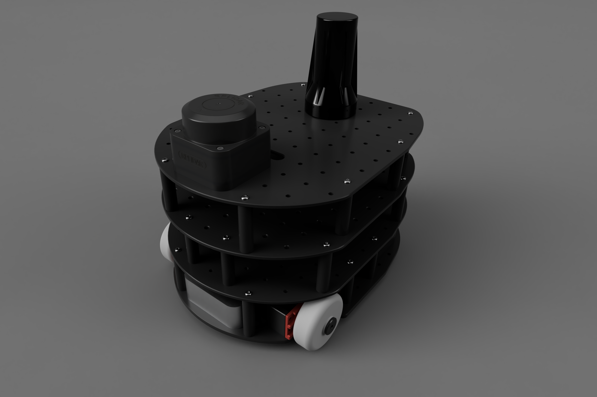
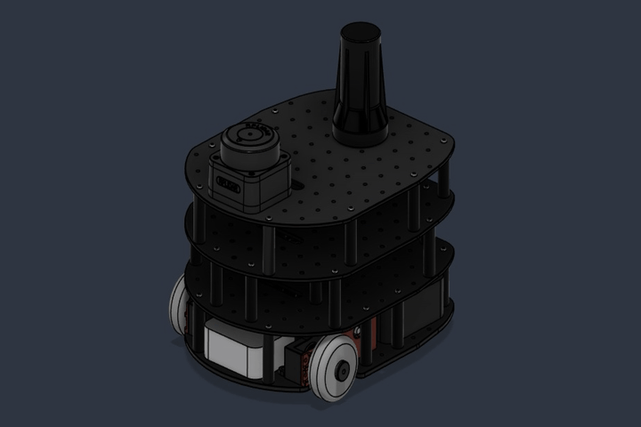

# Autonomous RF-Mapping & Cognitive Radio Rover

**High-resolution electromagnetic spatial analysis powered by ROS2, SDR, and Edge AI.**  
*Developed for **Jugend forscht 2026/2027***

<!-- Badges -->

 

<!-- Hero Images: Render and 360 GIF side by side -->

## Overview

Instead of relying on basic signal strength (RSSI), the system utilizes a **HackRF One** Software Defined Radio (SDR) and a **Google Coral Edge TPU** (M.2) to capture, process, and semantically classify broadband RF protocols (Wi-Fi, BLE, Zigbee, LoRa etc.) in real-time via a custom INT8-quantized Convolutional Neural Network (CNN).

## Key Features

- **Autonomous SLAM:** Mapping using **Cartographer ROS** driven by Direct-Time-of-Flight LiDAR scans and BNO085 IMU data.
- **Precision Kinematics:** Custom multi-deck chassis driven by TMC2209-stepped NEMA motors.
- **Cognitive Radio Pipeline:** Real-time extraction of Short-Time Fourier Transform (STFT) spectrograms from raw IQ data.
- **Edge AI Inference:** Protocol classification using a custom TensorFlow Lite model accelerated by a Google Coral Edge TPU.
- **Spatial Heatmapping:** Overlaying classified RF protocol data directly onto 2D LiDAR occupancy grids.

## System Architecture

### Current Hardware Stack
| Component | Description |
| :--- | :--- |
| **Compute** | Raspberry Pi 5 (1GB) |
| **Edge Accelerator** | Google Coral M.2 TPU (PCIe) |
| **RF Frontend** | HackRF One + UWB Omni-Antenna |
| **Spatial Sensors** | RPLidar C1 + BNO085 (9-DOF IMU) |
| **Motor Control** | Custom ESP32S3 + TMC2209 Driver board |

### Software Stack
- **OS & Middleware:** Ubuntu 24.04 LTS, ROS2 Jazzy
- **SLAM & Navigation:** Cartographer ROS, Nav2
- **Signal Processing:** GNU Radio, SciPy, NumPy (SigMF standard)
- **Machine Learning:** TensorFlow 2, Keras, Edge TPU Compiler

### Project Status & Roadmap (Work in Progress)

| Component / Milestone | Progress | Current Status & Next Steps |
| :--- | :--- | :--- |
| **Rev. 1 Physical Prototype** |  |  **Completed:** Initial chassis build and mechanical validation. |
| **Autonomous Navigation (Nav2 & SLAM)** |  |  **Finalizing:** 2D LiDAR SLAM & Nav2 stack ready, still problems with odometry |
| **Rev. 2 Physical Prototype** |  |  **In Progress:** Full CAD & electronics layout finished. |
| **RF Signal Classification (CNN Training)** |  |  **Early Stage:** Pipeline architecture set up; dataset recording awaits calibrated RF/UWB hardware. |
 
## Sponsors & Partners
This project is being developed for the Jugend forscht competition. We are actively looking for hardware partners. A huge thank you to the companies supporting the next generation of engineers:

## Contact

**Team:**
- **Ben Bluhm** – Lead Developer
- **Laura Übele** – Developer
- **Email:** [hello@54lab.dev](mailto:hello@54lab.dev)

**Get in Touch & Follow the Build:**

*Follow [@54lab.dev](https://www.instagram.com/54lab.dev/) on Instagram for regular build logs, 3D printing updates, and live testing videos!*
